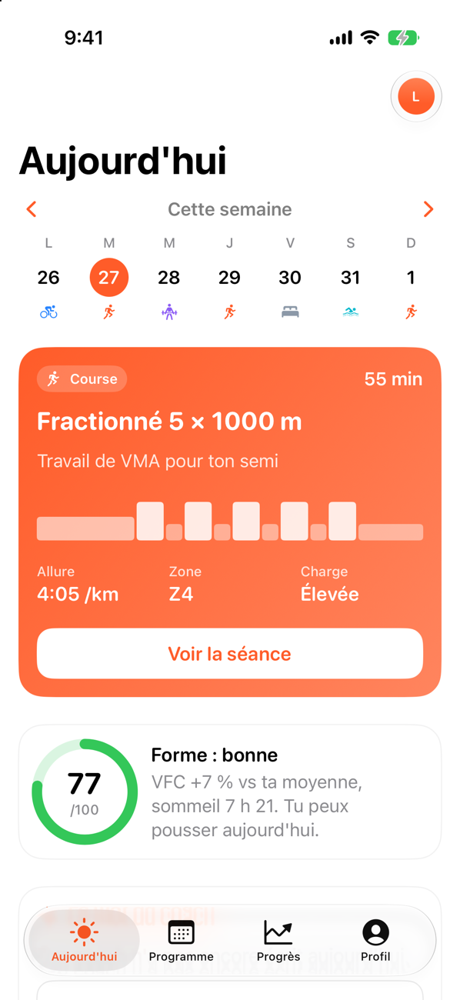
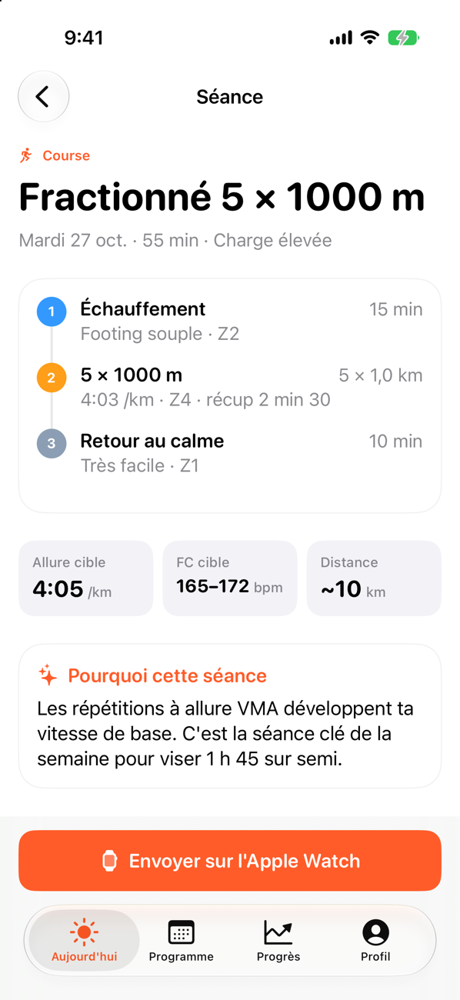
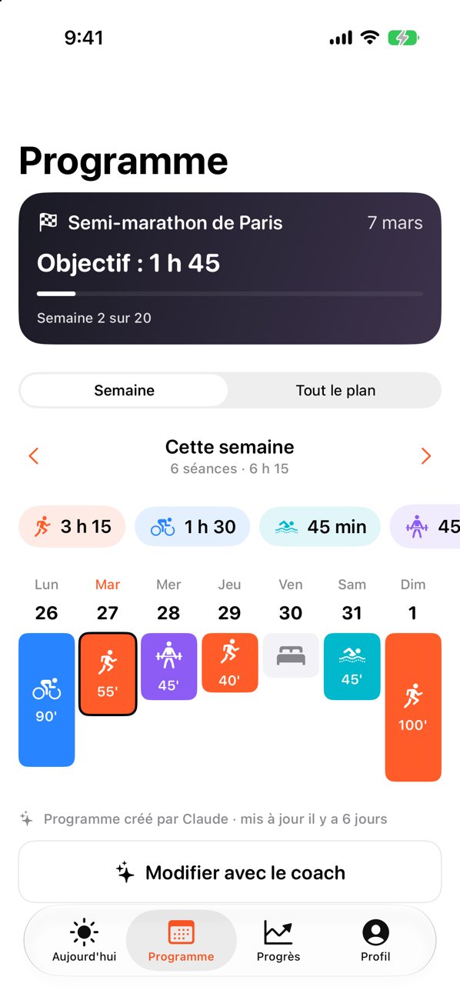
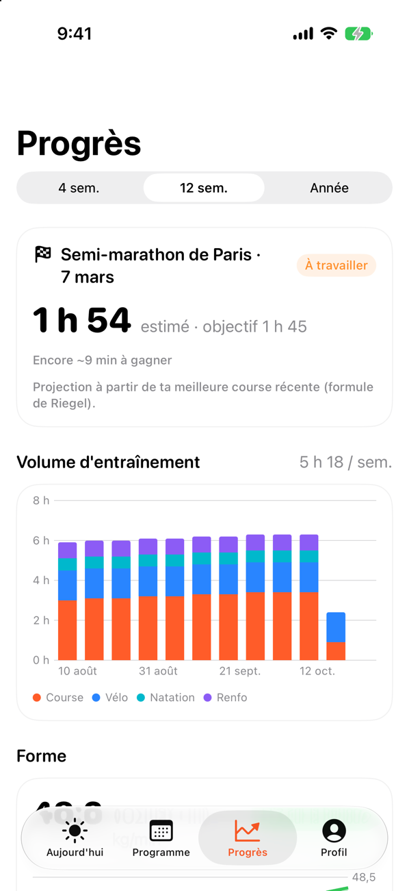

# Coach

An iOS app for multisport training (running, cycling, swimming, strength) where the coach is Claude.

The app doesn't have its own chat. It reads your workouts, sleep and heart rate from Apple Health, sends them to a small server, and that server is added to Claude as a custom connector. You talk to your coach in the Claude app; the plan, the daily note and the workout analyses it writes show up in Coach, and planned sessions can be sent to the Apple Watch.

<p>
  
  
  
  
</p>

The UI is in French and English (it follows the iPhone's language). The screens were designed in [UI Studio](https://github.com/LeoBrunet/UIStudio).

## How it works

```
Apple Watch → Apple Health → iOS app ──sync──► server ◄──MCP── Claude
                                  ▲               │
                                  └── plan, notes, analyses
```

- **iOS app** (`ios/`, SwiftUI, iOS 17+): reads Health data (workouts with laps, heart rate zones and route, sleep, HRV, resting heart rate, VO2 max), shows the day, the plan and progress, and schedules sessions on the Watch with WorkoutKit.
- **Server** (`server/`, TypeScript): a REST API for the app and an MCP endpoint for Claude, from the same codebase. It runs locally with Node and SQLite, or on Cloudflare Workers with D1.
- **Claude**: connected through the MCP endpoint, it reads your data and writes the plan (`upsert_sessions`), the daily note, workout analyses and profile updates.

## Requirements

- Xcode 26 or later, an iPhone (and an Apple Watch for real data)
- Node 20+ for the server
- A Claude plan that supports custom connectors

The iOS project uses UI Studio's `DesignKit` folder, so clone both repositories next to each other:

```bash
git clone https://github.com/LeoBrunet/UIStudio.git
git clone https://github.com/LeoBrunet/Coach.git
```

## Running locally

Start the server:

```bash
cd server
npm install
DATABASE_PATH=./dev.db npm run dev
```

Build and launch the app in the booted simulator:

```bash
ios/run.sh
```

In the simulator, allow Apple Health, then go to Profil › Réglages › Développement › "Générer des données de démo" to get 12 weeks of workouts.

Claude can't reach `localhost`, so to try the coach side locally there is a script that makes the same MCP calls (use the connector URL shown in the app):

```bash
cd server
npx tsx scripts/play-coach.ts "<connector URL>" plan 8     # goal + 8 weeks of sessions + daily note
npx tsx scripts/play-coach.ts "<connector URL>" analyze    # analyses for the latest workouts
```

Tests run the full loop (app API → server → MCP client):

```bash
cd server
npm test
COACH_TEST_URL=https://your-server.example npm test   # same tests against a deployment
```

## Deploying the server

The free Cloudflare plan is enough for one person (100k requests a day, 5 GB of D1).

```bash
cd server
npx wrangler login
npx wrangler d1 create coach      # copy the database id into wrangler.toml
npx wrangler deploy
```

Tables are created on the first request. Then point the app to the deployed URL: either change `COACH_SERVER_URL` in the Xcode build settings, or set it in the app under Réglages › Serveur.

## Connecting Claude

1. Open Coach and copy the connector URL (onboarding screen, or Profil › Réglages).
2. In Claude: Settings › Connectors › Add custom connector, and paste it.
3. Say hello to the coach. It will ask about your goal and availability, then build the plan.

The connector URL contains a secret token: anyone who has it can read and change your training data.

## Installing on an iPhone

Set your own team in the Xcode project (`DEVELOPMENT_TEAM`) and change the bundle identifier. A free Apple account works, HealthKit included, but the app has to be reinstalled every 7 days.

## Project layout

```
ios/
  Coach/App/         app state, sync, API client setup
  Coach/Features/    Today, Plan, Session, Progress, Profile, Onboarding
  Coach/Services/    HealthKit, WorkoutKit, server API, links to Claude
  Coach/Models/      models and computed insights (records, readiness, projections)
  run.sh             build + launch in the simulator
server/
  src/app.ts         routes (Hono)
  src/api.ts         REST API for the app
  src/mcp.ts         MCP tools and the coach's instructions
  src/readiness.ts   7-day HRV / resting HR vs 60-day baseline, training load ratio
  src/store.ts       data access (SQLite locally, D1 on Cloudflare)
  scripts/           play-coach.ts
```

## Notes

- HealthKit and WorkoutKit need a real device for real data; in the simulator, sending a session to the Watch succeeds but there is no Watch.
- The readiness score shown on the Today screen is a simple formula (sleep, HRV and resting heart rate against your own averages), not a medical measure.
